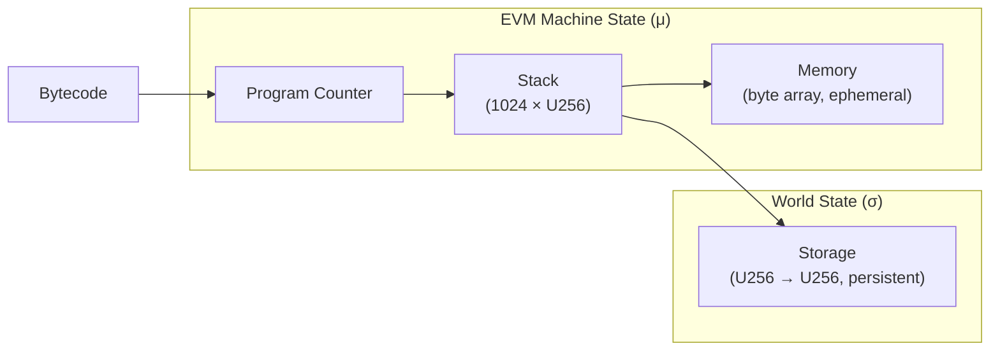

# What is the EVM?

The **Ethereum Virtual Machine** (EVM) is a deterministic, stack-based virtual machine that executes smart contract bytecode. Every Ethereum node runs the same EVM implementation, and given the same input state and transaction, every node must produce the exact same output. This determinism is what makes decentralized consensus possible.

## The mental model

I found it helpful to think of the EVM as a sandboxed calculator with three scratch spaces:



1. **Stack** — a LIFO array of 256-bit values, max depth 1024
2. **Memory** — a byte-addressable, expandable byte array, wiped after each call
3. **Storage** — a persistent key-value map (256-bit → 256-bit) tied to each contract account

The EVM reads **bytecode** — a sequence of single-byte opcodes, some followed by immediate data — and executes them one by one. The program counter (PC) advances linearly unless a `JUMP` or `JUMPI` instruction redirects it.

## Why 256-bit words?

One of the first things I wondered was why Ethereum chose 256-bit (32-byte) words. There are a few reasons:

- **Keccak-256** is the hashing algorithm used throughout Ethereum. Its output is 32 bytes, so stack values can hold a full hash.
- **Addresses** are 20 bytes — they fit comfortably in a 32-byte word.
- **Cryptographic security**: 256-bit keys provide 128-bit security against brute-force attacks, which is the standard target for modern cryptography.

```admonish tip title="Rust Pattern: Newtype"
The newtype pattern (`struct U256([u8; 32])`) gives us type safety — you can't accidentally pass a raw byte array where a U256 is expected — plus a namespace for methods and operator overloading.
```

## Yellow Paper notation

The Ethereum Yellow Paper uses Greek letters for the machine state:

| Symbol | Meaning | Our Rust type |
|--------|---------|---------------|
| σ (sigma) | World state (all accounts) | — (Day 3+) |
| μ | Machine state | — (the interpreter struct) |
| μ_s | Stack | `Stack` |
| μ_m | Memory | `Memory` |
| μ_g | Gas remaining | `u64` (Day 2) |
| μ_pc | Program counter | `usize` (Day 2) |

The execution model is a pure function:

```
(σ, μ, I) → (σ', μ', output)
```

Where `I` is the execution environment (caller, value, bytecode, etc.). Given the same inputs, the outputs are always the same. No randomness, no system calls, no I/O.

## What we build on Day 1

On Day 1 we implement the three core data structures without writing a single opcode. These are the substrate the interpreter will live in:

| Module | File | What it is |
|--------|------|------------|
| `U256` | [`src/types/u256.rs`](https://github.com/jonaprieto/toyevm/blob/main/src/types/u256.rs) | 256-bit unsigned integer |
| `Stack` | [`src/stack.rs`](https://github.com/jonaprieto/toyevm/blob/main/src/stack.rs) | Bounded LIFO stack (max 1024) |
| `Memory` | [`src/memory.rs`](https://github.com/jonaprieto/toyevm/blob/main/src/memory.rs) | Byte-addressable linear memory |
