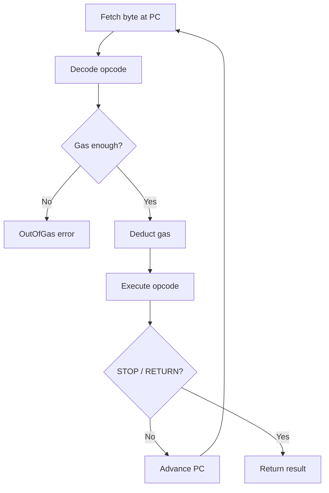

# Bytecode and the Execution Loop

Today we bring the EVM to life. By the end of this chapter, I want our interpreter to execute arithmetic bytecode, track gas consumption, and return results — a complete fetch-decode-execute loop.

## How bytecode works

EVM bytecode is a flat array of bytes. Each byte is either:
- An **opcode** (a single-byte instruction), or
- An **immediate** byte following a PUSH instruction

The program counter ($\mu_{pc}$ in the [Yellow Paper](https://ethereum.github.io/yellowpaper/paper.pdf)) starts at 0 and advances linearly. When the interpreter encounters `PUSH3`, it needs to read the opcode byte, then consume the next 3 bytes as the immediate value, advancing the PC by 4 total (1 + 3).

Example bytecode: `60 03 60 05 01 00`

```
Offset  Byte  Meaning
0x00    0x60  PUSH1
0x01    0x03    immediate: 3
0x02    0x60  PUSH1
0x03    0x05    immediate: 5
0x04    0x01  ADD
0x05    0x00  STOP
```

This pushes 3, pushes 5, adds them (result: 8 on stack), and stops.

## The fetch-decode-execute loop



I found that our interpreter follows the classic pattern:

```
loop {
    byte = bytecode[pc]
    opcode = decode(byte)         // Opcode::from_byte
    gas_remaining -= cost(opcode) // static gas deduction
    execute(opcode)               // match on opcode enum
}
```

The loop terminates when:
- **STOP** is reached (return empty, success)
- **RETURN** is reached (return memory slice, success)
- **REVERT** is reached (return memory slice, reverted)
- The PC goes past the end of bytecode (implicit STOP)
- An error occurs (out of gas, invalid opcode, stack error)

## Dispatch: match vs. HashMap

I went with a Rust `match` on a `repr(u8)` enum rather than a `HashMap<u8, fn()>`. Why?

- The compiler generates a **jump table** — a single indexed memory access, O(1)
- No heap allocation, no hashing overhead
- The `match` is exhaustive — the compiler ensures every opcode variant is handled
- In production EVMs like `revm`, dispatch is the hottest code path; every nanosecond matters

```admonish tip title="Beyond a simple enum: OpCodeInfo"
Our `Opcode` enum maps each byte to a name, plus an `immediate_size()` method. A production EVM would attach more metadata per opcode — something like:

| Field | Type | Purpose |
|-------|------|---------|
| `name` | `&str` | Disassembly output |
| `immediate_size` | `u8` | Bytes following the opcode (0 for all but PUSH) |
| `min_stack` | `u8` | Minimum stack depth to execute |
| `stack_increase` | `u8` | Net stack growth after execution |
| `static_gas` | `u32` | Base gas cost |
| `dynamic_gas` | `bool` | Whether runtime gas is also needed |
| `index` | `u8` | N for PUSHN/DUPN/SWAPN/LOGN, 0 otherwise |

This `OpCodeInfo` struct lets the interpreter validate stack depth and deduct gas *before* dispatching — no need to check inside each handler. We keep it simple here, but this is the direction `revm` and `evmone` take.
```

## PUSH1 through PUSH32

The PUSH family is special: each opcode is followed by 1-32 immediate bytes that form the value to push. I noticed the bytes are read in **big-endian** order and right-aligned into a 32-byte U256.

All PUSH opcodes cost the same gas (3, the "very low" tier). The immediate bytes are not separate instructions — they're data embedded in the bytecode stream.

## BYTE, SHL, SHR, and SAR — Bit-level access

These four opcodes sit in the `0x1A`–`0x1D` range, right after the logical operators (`AND`, `OR`, `XOR`, `NOT`). They all cost 3 gas ("very low" tier) and are pure stack-to-stack operations with no side effects. Despite being easy to implement, they show up constantly in real compiled code — understanding them early pays off.

### Why these matter

Solidity's **function dispatch** relies on `SHR`. Every external call begins with the ABI selector: the first 4 bytes of calldata. The compiler emits `CALLDATALOAD` to read 32 bytes, then `SHR 224` to right-shift away the lower 28 bytes, isolating the 4-byte selector. If you don't implement `SHR`, you can't run even the simplest Solidity contract with more than one function.

`SHL` appears in ABI encoding, address masking (`AND` with `SHL 160` minus one), and packing multiple values into a single storage slot. `BYTE` is used when contracts inspect individual bytes of a word — for example, iterating over an address byte-by-byte in a checksum routine. `SAR` (arithmetic right shift) preserves the sign bit, which matters for signed integer division: `x / 2` on a negative `int256` compiles to `SAR 1` rather than `SHR 1`.

### BYTE — extract a single byte

`BYTE` pops an index $i$ (top) and a word $x$ (second), then pushes the $i$-th byte of $x$ counting from the **most significant** end. Indices 0–31 are valid; any $i \geq 32$ pushes zero.

```
PUSH32 0xFF00...00   # byte 0 is 0xFF, bytes 1-31 are 0x00
PUSH1  0x00          # index 0
BYTE                 # → 0xFF
```

The [Yellow Paper](https://ethereum.github.io/yellowpaper/paper.pdf) defines this as $\texttt{BYTE}(i, x) = (x \gg (248 - 8i)) \;\text{mod}\; 256$ for $i < 32$, and $0$ otherwise. Notice the big-endian convention — byte 0 is the *most* significant, matching Ethereum's standard byte ordering.

### SHL — shift left

`SHL` pops a shift amount (top) and a value (second), then pushes $\textit{value} \ll \textit{shift}$. Bits shifted past position 255 are discarded (the result is mod $2^{256}$). A shift $\geq 256$ always yields zero.

```
PUSH1  0x01          # value: 1
PUSH1  0x08          # shift: 8 bits
SHL                  # → 0x100 (256)
```

### SHR — logical shift right

`SHR` pops a shift amount (top) and a value (second), then pushes $\textit{value} \gg \textit{shift}$. Vacated high bits are filled with zeros. A shift $\geq 256$ always yields zero.

```
PUSH2  0x0100        # value: 256
PUSH1  0x08          # shift: 8 bits
SHR                  # → 0x01 (1)
```

The selector-extraction pattern we mentioned looks like this in bytecode:

```
PUSH1 0x00
CALLDATALOAD         # load 32 bytes from calldata offset 0
PUSH1 0xE0           # 224 in decimal
SHR                  # isolate the top 4 bytes → function selector
```

### SAR — arithmetic shift right

`SAR` works like `SHR` but preserves the sign bit. If the most significant bit of the value is 1 (a negative two's-complement number), the vacated high bits are filled with ones instead of zeros.

```
# -2 in two's complement is 0xFFFF...FFFE
PUSH32 0xFFFFFFFFFFFFFFFFFFFFFFFFFFFFFFFFFFFFFFFFFFFFFFFFFFFFFFFFFFFFFFFE
PUSH1  0x01          # shift: 1 bit
SAR                  # → 0xFFFF...FFFF (which is -1)
```

With `SHR`, the same shift would produce `0x7FFF...FFFF` — a large positive number, not $-1$. This is why the Solidity compiler picks `SAR` for signed division by powers of two.

```admonish info title="EIP-145: Bitwise Shifting"
`SHL`, `SHR`, and `SAR` were added in the Constantinople upgrade (2019) via [EIP-145](https://eips.ethereum.org/EIPS/eip-145). Before that, shifting required `MUL`/`DIV` by powers of two and `EXP` — far more expensive. The EIP benchmarked a 10x speedup for common bit operations. Every post-Constantinople EVM must support them.
```
