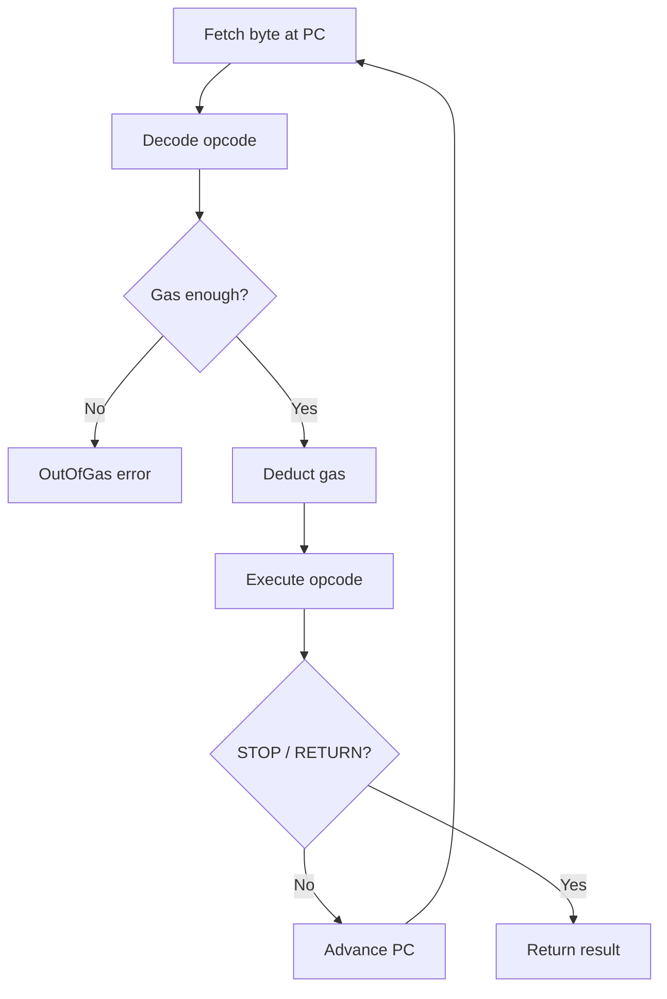

# Bytecode and the Execution Loop

Today we bring the EVM to life. By the end of this chapter, I want our interpreter to execute arithmetic bytecode, track gas consumption, and return results — a complete fetch-decode-execute loop.

## How bytecode works

EVM bytecode is a flat array of bytes. Each byte is either:
- An **opcode** (a single-byte instruction), or
- An **immediate** byte following a PUSH instruction

The program counter (μ_pc in the Yellow Paper) starts at 0 and advances linearly. When the interpreter encounters `PUSH3`, it needs to read the opcode byte, then consume the next 3 bytes as the immediate value, advancing the PC by 4 total (1 + 3).

Example bytecode: `60 03 60 05 01 00`

```
Offset  Byte  Meaning
0x00    0x60  PUSH1
0x01    0x03    immediate: 3
0x02    0x60  PUSH1
0x03    0x05    immediate: 5
0x04    0x01  ADD
0x05    0x00  STOP
```

This pushes 3, pushes 5, adds them (result: 8 on stack), and stops.

## The fetch-decode-execute loop



I found that our interpreter follows the classic pattern:

```
loop {
    byte = bytecode[pc]
    opcode = decode(byte)         // Opcode::from_byte
    gas_remaining -= cost(opcode) // static gas deduction
    execute(opcode)               // match on opcode enum
}
```

The loop terminates when:
- **STOP** is reached (return empty, success)
- **RETURN** is reached (return memory slice, success)
- **REVERT** is reached (return memory slice, reverted)
- The PC goes past the end of bytecode (implicit STOP)
- An error occurs (out of gas, invalid opcode, stack error)

## Dispatch: match vs. HashMap

I went with a Rust `match` on a `repr(u8)` enum rather than a `HashMap<u8, fn()>`. Why?

- The compiler generates a **jump table** — a single indexed memory access, O(1)
- No heap allocation, no hashing overhead
- The `match` is exhaustive — the compiler ensures every opcode variant is handled
- In production EVMs like `revm`, dispatch is the hottest code path; every nanosecond matters

## PUSH1 through PUSH32

The PUSH family is special: each opcode is followed by 1-32 immediate bytes that form the value to push. I noticed the bytes are read in **big-endian** order and right-aligned into a 32-byte U256.

All PUSH opcodes cost the same gas (3, the "very low" tier). The immediate bytes are not separate instructions — they're data embedded in the bytecode stream.
