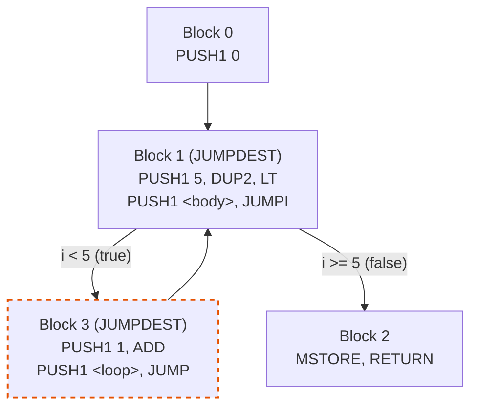

# From Bytecode to IR: Control Flow Graphs

On Day 6 I shifted from executing bytecode to **analyzing** it. We lift the flat byte stream into a structured intermediate representation (IR) of basic blocks connected by control flow edges.

## Why analyze bytecode?

Direct interpretation has limits. To optimize, we need structure:
- Which code is reachable? (Dead code elimination)
- Which values are used? (Constant folding, redundant load removal)
- What does the control flow look like? (Loop detection, inlining)

The **control flow graph** (CFG) is the compiler's primary IR for answering these questions.

## Basic blocks

A **basic block** is a maximal sequence of instructions with:
- **One entry point** (the first instruction)
- **One exit point** (the last instruction)
- **No internal jumps** — if the first instruction executes, all instructions in the block execute

```admonish note title="Why basic blocks matter"
Because all instructions in a block execute together, we can reason about the block's effect as a single atomic operation: "this block pops 2 values and pushes 1." This net-effect summary is what enables optimization passes to work at scale without analyzing individual instructions across control flow boundaries.
```

A **leader** (the first instruction of a block) is identified by three rules:
1. The first byte of the bytecode (offset 0)
2. Any `JUMPDEST` instruction
3. The instruction immediately after a `JUMP`, `JUMPI`, `STOP`, `RETURN`, `REVERT`, or `INVALID`

### Worked example

Given bytecode `PUSH1 4, JUMP, INVALID, JUMPDEST, STOP`:

```
Offset  Byte  Opcode     Leader?   Why
0x00    0x60  PUSH1      ✓ (1)     First instruction
0x01    0x04  (imm)
0x02    0x56  JUMP
0x03    0xFE  INVALID    ✓ (3)     After JUMP
0x04    0x5B  JUMPDEST   ✓ (2)     JUMPDEST
0x05    0x00  STOP
```

Leaders: `{0x00, 0x03, 0x04}` → 3 basic blocks.

## CFG edges

Edges represent possible control flow between blocks:

| Last instruction | Outgoing edges |
|-----------------|----------------|
| Fall-through (no terminator) | 1 edge to next block |
| `JUMP` | 1 edge to target (if statically resolvable) |
| `JUMPI` | 2 edges: true branch (target) + false branch (fall-through) |
| `STOP` / `RETURN` / `REVERT` / `INVALID` | 0 edges (terminal) |

Here's the CFG for the loop bytecode from Day 3 (`i = 0; while i < 5: i++; return i`):



Note the **back-edge** B3→B1: this is a loop. A back-edge points to a block that *dominates* the source — block B1 dominates B3 because every path from entry to B3 goes through B1.

## Static jump resolution

EVM jumps are technically **dynamic** — the destination is a value popped from the stack at runtime. But in practice:

| Source | Jump resolution |
|--------|----------------|
| **Solidity/Vyper compiled** | Almost all PUSH+JUMP — statically resolvable |
| **Function dispatch** | PUSH+DUP+EQ+PUSH+JUMPI chain — resolvable with pattern matching |
| **Handwritten (Huff)** | May compute destinations dynamically — requires abstract interpretation |
| **EOF (EVM Object Format)** | `RJUMP`/`RJUMPI` with relative offsets — always static, no JUMPDEST needed |

My CFG builder looks for the simplest pattern — a `PUSH` immediately before `JUMP`/`JUMPI`:

```rust
fn resolve_static_jump(&self, block_id: BlockId) -> Option<usize> {
    let instructions = &self.blocks[&block_id].instructions;
    let push_inst = &instructions[instructions.len() - 2];
    if !push_inst.opcode.is_push() { return None; }
    // Convert immediate bytes to offset
    ...
}
```

```admonish warning title="Limitation: Non-Adjacent PUSH"
If a DUP or SWAP separates the PUSH from the JUMP (common in function dispatch tables), my resolver returns `None` and the edge is missing from the CFG. A production analyzer would track the stack symbolically to resolve these cases.
```

## Stack height analysis

I track the stack height at the entry and exit of each block — a **forward dataflow analysis**.

### The algorithm

1. Initialize: entry block has height 0
2. For each block on the worklist, simulate all instructions:
   - $h \leftarrow h - \text{inputs} + \text{outputs}$ for each instruction
3. Propagate exit height to all successors
4. If a successor hasn't been visited, add it to the worklist

```admonish tip title="Why the worklist terminates"
Each block is processed at most once (we skip if already in `entry_height`). With $N$ blocks, the worklist drains in at most $N$ iterations. This is an $O(N \cdot I)$ algorithm where $I$ is the average instructions per block.
```

### At join points

When two blocks both flow into the same successor, the successor should have the *same* stack height from both paths — the EVM specification requires this. My simplified analysis takes the first height it sees and ignores conflicts. A production verifier would check that all incoming heights agree and reject the bytecode if they don't.

## Use/def sets

For each block, we compute two values:

- **uses** — how many stack slots does this block consume from the *entry* stack?
- **defs** — how many stack slots does this block produce *beyond* what it consumed?

The computation tracks the minimum net height during execution:

$$\text{uses} = \max(0, -\min_k h_k), \quad \text{defs} = \max(0, h_n - \min_k h_k)$$

where $h_k$ is the cumulative net stack effect after instruction $k$.

Example: `PUSH1 1, PUSH1 2, ADD, STOP`
- After PUSH1: $h = +1$
- After PUSH1: $h = +2$
- After ADD: $h = +1$ (consumed 2, produced 1)
- After STOP: $h = +1$
- $\min = 0$ (never went below 0), so uses = 0, defs = 1

Example: `POP, STOP`
- After POP: $h = -1$
- After STOP: $h = -1$
- $\min = -1$, so uses = 1, defs = 0

## Liveness (block reachability)

My "liveness" analysis determines which *blocks* are live — reachable from entry AND can reach an exit. This is two BFS passes:

1. **Forward BFS** from entry → `reachable_from_entry`
2. **Backward BFS** from exit blocks (STOP/RETURN/REVERT) → `can_reach_exit`
3. **Live** = intersection

Dead blocks (unreachable, or can't reach any exit) are safe to eliminate.

```admonish note title="Block-level vs. value-level liveness"
This is block reachability, not true value-level liveness. True liveness tracks which *stack slots* are live at each program point — needed for removing dead PUSHes within reachable blocks. Our simplified model only removes entire unreachable blocks, not dead instructions within live blocks.
```

## Connection to real-world tools

| Tool | What it does | Relation to our code |
|------|-------------|---------------------|
| **revm** (analysis pass) | Pre-validates JUMPDEST table, caches gas | Our `find_leaders` + `compute_jumpdests` |
| **revmc** (JIT/AOT) | Lifts to LLVM IR, compiles to native | Our CFG → Day 7 optimization → (would need LLVM backend) |
| **evm_mlir** | LambdaClass's MLIR-based AOT compiler | Full CFG + dominator tree + SSA |
| **EOF** | New bytecode format ([EIP-3540](https://eips.ethereum.org/EIPS/eip-3540) family) | Eliminates dynamic jumps entirely — CFG is trivial |

## Exercises

- **6.1** — Leader identification on sample bytecode
- **6.2** — Block extraction: correct number of blocks
- **6.3** — Fall-through edges for sequential code
- **6.4** — JUMP edge resolution
- **6.5** — JUMPI produces two outgoing edges
- **6.6** — Entry and exit block identification
- **6.7** — Stack height tracking (forward dataflow)
- **6.8** — Use/def set computation
- **6.9** — Liveness worklist convergence

Run: `cargo test compiler`
