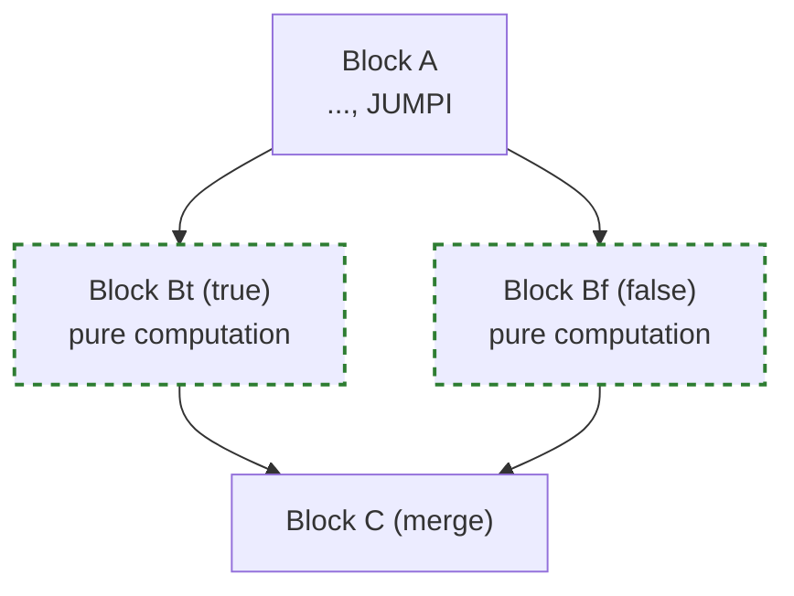

# Optimization Passes

In Module 7 I closed the loop: we take the CFG from Module 6 and transform it. Two classic optimization passes — constant folding and dead code elimination — demonstrate the fundamental techniques that production compilers like `evm_mlir` use at scale. I also explored how to make the interpreter itself faster — the techniques that separate a naive EVM from a production one.

## The OptimizationPass trait

Every optimization conforms to a common interface:

```rust
pub trait OptimizationPass {
    fn run(&self, cfg: &mut Cfg) -> usize;  // returns number of changes
    fn name(&self) -> &str;
}
```

This enables **fixed-point iteration**: run all passes in a loop until none of them make changes. The trait is the standard pattern for composable compiler passes — LLVM, GCC, and Cranelift all use variations of this interface.

```admonish tip title="Rust Pattern: Trait Objects for Passes"
We can collect passes into a `Vec<Box<dyn OptimizationPass>>` and iterate over them generically. This decouples the pass manager from the individual passes — adding a new optimization requires no changes to the driver loop.
```

## Constant Folding

The simplest optimization: if both operands of an arithmetic operation are compile-time constants, evaluate it now and replace the three instructions with a single PUSH.

**Before:**
```
PUSH1 3    ; 3 gas
PUSH1 5    ; 3 gas
ADD        ; 3 gas
           ; total: 9 gas, 3 instructions
```

**After:**
```
PUSH1 8    ; 3 gas
           ; total: 3 gas, 1 instruction
```

This saves 6 gas per fold — a 67% reduction for this pattern. Across a contract with many constant expressions (e.g., ABI offset calculations, storage slot computations), the savings accumulate significantly.

### Chained folding

Consider: `PUSH1 2, PUSH1 3, MUL, PUSH1 4, MUL`. The first pass folds `(2, 3, MUL)` → `PUSH1 6`. The second pass sees `(PUSH1 6, PUSH1 4, MUL)` and folds to `PUSH1 24`. This is why we need **fixed-point iteration** — a single pass isn't enough.

The fixed-point loop terminates because each iteration strictly reduces the instruction count (three instructions become one). With $N$ instructions, at most $N/2$ folds can occur, so the loop terminates in $O(N)$ iterations.

```admonish warning title="Pitfall: Division by Zero in Folding"
When folding `PUSH 5, PUSH 0, DIV`, the result must match the EVM specification: division by zero returns zero (not a panic). The `evaluate_binop` function must handle this case explicitly.
```

## Dead Code Elimination

DCE removes blocks that are unreachable from the entry or cannot reach any exit. This uses the liveness analysis from Module 6.

A block is **dead** if:
- It's unreachable from the entry block (forward), OR
- It cannot reach any exit block (backward)

Example:
```
Block 0: PUSH1 4, JUMP → Block 2
Block 1: INVALID        ← unreachable! (DCE removes this)
Block 2: JUMPDEST, STOP
```

```admonish note title="Why We Don't Remove the Entry Block"
Even if static analysis cannot prove the entry block reaches an exit (e.g., all outgoing jumps are dynamically resolved), the entry block must be preserved — removing it would destroy the program.
```

## Making the interpreter faster

My interpreter works correctly, but it is far from optimal. Production EVMs like [revm](https://github.com/bluealloy/revm) use several techniques to minimize per-opcode overhead. These are the techniques that matter most, ordered by impact.

### 1. JUMPDEST bitmap pre-computation

Every `JUMP`/`JUMPI` must validate that the target is a `JUMPDEST`. A naive approach scans the bytecode on each jump — $O(N)$ per jump. Instead, pre-compute a bitmap at contract load time:

```rust
fn compute_jumpdest_bitmap(bytecode: &[u8]) -> Vec<bool> {
    let mut bitmap = vec![false; bytecode.len()];
    let mut i = 0;
    while i < bytecode.len() {
        if bytecode[i] == 0x5B { // JUMPDEST
            bitmap[i] = true;
        }
        // Skip PUSH immediates
        if (0x60..=0x7F).contains(&bytecode[i]) {
            i += (bytecode[i] - 0x5F) as usize;
        }
        i += 1;
    }
    bitmap
}
```

Jump validation becomes a single array lookup: $O(1)$ instead of $O(N)$.

### 2. Padded bytecode (bounds-check elimination)

The interpreter's hot loop checks `pc < bytecode.len()` on every iteration. By appending STOP bytes to the bytecode (padding to the next cache-line boundary), the bounds check becomes redundant — running past the end hits a STOP and halts normally.

```rust
let mut padded = bytecode.to_vec();
padded.resize(padded.len() + 33, 0x00); // 33 for max PUSH32 + STOP
```

This eliminates a branch from the hottest loop in the program. At billions of iterations per block, even one fewer branch per iteration matters.

### 3. Gas pre-computation

Instead of looking up gas costs in a match table on every opcode dispatch, pre-compute the static gas cost for each instruction at analysis time and store it alongside the opcode:

```rust
struct AnalyzedOp {
    opcode: Opcode,
    static_gas: u64,
    // immediate bytes already decoded
}
```

The interpreter can then deduct gas with a single subtraction, no dispatch needed. Dynamic gas (memory expansion, SLOAD cold/warm) still requires runtime logic, but static gas covers the majority of opcodes.

### 4. `repr(u8)` jump table dispatch

Our opcode enum already uses `#[repr(u8)]`, which Rust compiles into a jump table — a single indexed memory load rather than a chain of if-else comparisons. This is $O(1)$ dispatch with good branch-predictor behavior.

The key detail: the `match` must be **exhaustive** and the enum values must be **dense** (no large gaps). Both conditions hold for EVM opcodes. This is the same technique Python's CPython ceval loop and the HotSpot JVM interpreter use.

### 5. Stack representation

Our stack uses `Vec<U256>`, which is heap-allocated. A production interpreter might use a fixed-size array on the stack frame:

```rust
struct FastStack {
    data: [U256; 1024],  // fixed-size, no heap allocation
    top: usize,
}
```

This avoids heap allocation entirely and improves cache locality — the entire stack fits in L1/L2 cache.

```admonish note title="Benchmark before optimizing"
These techniques are well-known, but their impact depends on the workload. Always profile with realistic contracts before optimizing. The [evm.codes playground](https://www.evm.codes/playground) and [Foundry's `forge test --gas-report`](https://getfoundry.sh/forge/gas-tracking) are useful for generating realistic benchmarks.
```

## Superinstructions (bonus concept)

A **superinstruction** fuses a common sequence into a single compound opcode. For example, `PUSH1 x, PUSH1 y, ADD` could become `PUSHADD x y` — one dispatch instead of three. This reduces interpreter loop overhead and can enable further constant folding.

Common EVM superinstruction candidates (from profiling real contract bytecode):

| Pattern | Frequency | Savings |
|---------|-----------|---------|
| `PUSH1, PUSH1, ADD/MUL` | Very high (offset math) | 2 dispatches |
| `DUP1, PUSH1, LT/GT` | High (loop bounds) | 1 dispatch |
| `PUSH1, MLOAD/MSTORE` | High (memory access) | 1 dispatch |
| `ISZERO, PUSH, JUMPI` | High (conditional branch) | 2 dispatches |

Production interpreters like CPython and LuaJIT use superinstructions extensively. In the EVM context, `revm`'s analysis phase effectively does this by pre-computing gas costs and skipping redundant checks.

## Speculative pre-execution over the CFG

With the CFG from Module 6 in hand, we can go beyond static analysis: **speculatively execute** both arms of a conditional branch before the condition is resolved. The idea is borrowed from CPU branch prediction — but applied at the bytecode level.

### The problem

At a `JUMPI`, the interpreter must evaluate the condition to decide which block to enter. Until the condition is known, the pipeline stalls. In a tight loop with expensive setup (e.g., loading storage values), this stall happens on every iteration.

### The idea

Given a `JUMPI` with two outgoing CFG edges (true → block $B_t$, false → block $B_f$), we can:

1. **Fork the machine state** — snapshot the stack, memory, and gas counter
2. **Execute both successors** on their own snapshot
3. **When the condition resolves**, discard the wrong path and adopt the correct one

If the speculated path has no side effects (no `SSTORE`, `LOG`, `CALL`, etc.), we gain a head start on whichever branch is taken.

### When it helps

Speculative pre-execution is profitable when:
- The condition depends on a value that is **expensive to compute** (e.g., an SLOAD or a deep arithmetic chain)
- Both successor blocks are **short and side-effect-free** (pure stack/memory computation)
- The CFG shows a **diamond pattern** (both branches reconverge quickly)



In this diamond, blocks $B_t$ and $B_f$ are both speculated. Once the condition resolves, we pick the correct result and continue into block C.

### When it does not help

Speculation is wasted (or dangerous) when:
- A successor block has **side effects** — `SSTORE`, `LOG`, `CALL`, `CREATE`, `SELFDESTRUCT`. These cannot be rolled back.
- The block is **long or gas-heavy** — speculating a 500-instruction block costs real gas even if the result is discarded.
- The CFG has **deep divergence** — if the two paths don't reconverge quickly, the speculated state grows unboundedly.

### Safety check using the CFG

The CFG gives us the information we need to decide whether speculation is safe:

```rust
fn is_safe_to_speculate(cfg: &Cfg, block_id: BlockId) -> bool {
    let block = &cfg.blocks[&block_id];
    block.instructions.iter().all(|inst| {
        !matches!(
            inst.opcode,
            Opcode::SSTORE
                | Opcode::LOG0 | Opcode::LOG1 | Opcode::LOG2
                | Opcode::LOG3 | Opcode::LOG4
                | Opcode::CALL | Opcode::DELEGATECALL | Opcode::STATICCALL
                | Opcode::CREATE | Opcode::CREATE2
                | Opcode::SELFDESTRUCT
        )
    })
}
```

This is a conservative check: if every instruction in the block is pure (stack, memory, arithmetic), we can safely speculate it.

### Connection to real systems

| System | Technique | Similarity |
|--------|-----------|------------|
| **CPU branch prediction** | Execute both pipeline paths, flush the wrong one | Same idea, hardware level |
| **JVM HotSpot** | Speculative inlining based on profiling | Speculates on call targets, deoptimizes on miss |
| **Trace-based JITs** (LuaJIT) | Record a trace for the hot path, fall back on deviation | Speculates the entire loop body |
| **Database query engines** | Speculative prefetch based on predicate selectivity | Same fork-and-choose pattern |

In the EVM context, speculative pre-execution is most useful in an **AOT compiler** or **analysis tool** — not in a production interpreter (where the overhead of forking state per `JUMPI` would dominate). But as a learning exercise, it ties together everything from Modules 6 and 7: the CFG gives you the graph, liveness tells you which blocks matter, and the side-effect check tells you which blocks are safe.

```admonish tip title="Exercise idea"
Extend the CFG with a method `speculative_candidates(&self) -> Vec<(BlockId, BlockId)>` that returns all JUMPI blocks where **both** successors are safe to speculate. Run it on the loop bytecode from Module 3 and verify that the loop body qualifies.
```

## AOT Compilation (discussion)

My optimizer works on the IR but still outputs bytecode for the interpreter. The next step would be **ahead-of-time compilation**: transpile the CFG into native machine code.

This is exactly what [LambdaClass's evm_mlir](https://blog.lambdaclass.com/evm-performance-boosts-with-mlir/) does:

1. **Lift** EVM bytecode → MLIR dialect (each opcode becomes an MLIR operation)
2. **Optimize** with standard MLIR passes (constant folding, DCE, LICM)
3. **Lower** to LLVM IR
4. **Codegen** via LLVM backend → native x86/ARM

Their benchmarks show **3–7x speedup** over interpretation (varying by contract and hardware). The key insight: gas metering is compiled as a counter decrement at each basic block entry, not checked per-opcode.


## JIT vs. AOT in blockchain context

A **JIT compiler** compiles code on-the-fly during execution; an **AOT compiler** compiles before execution begins.

| | JIT | AOT |
|---|-----|-----|
| **Startup** | Slow (compile on first call) | Slow (compile at deploy) |
| **Steady-state** | Fast (native code) | Fast (native code) |
| **Determinism** | Harder (optimization choices vary) | Easier (compile once, cache) |
| **Cache** | Must invalidate on upgrade | Stored with contract |

Blockchain requires **deterministic execution** — every node must produce the same result. JIT is risky because different optimization levels could produce different gas measurements. AOT with a fixed compilation pipeline is safer.

[evm_mlir](https://blog.lambdaclass.com/evm-performance-boosts-with-mlir/) takes the AOT approach for this reason.

## Why not JIT?

A question I kept coming back to: if native code is faster, why don't production EVMs just JIT-compile everything?

It turns out the EVM workload is a poor fit for JIT compilation. Several factors work against it:

1. **Compilation latency.** Even at `-O0`, LLVM takes milliseconds per contract. A blockchain node processes thousands of transactions per block — if each contract is compiled on first call, the compilation overhead dominates. A contract called once never amortizes the cost.

2. **Code size and cache pressure.** JIT-compiled native code is larger than the bytecode it replaces. Thousands of compiled contracts fill the instruction cache. Cache misses on x86 cost 100+ cycles each — enough to wipe out the gains from native execution.

3. **Branch prediction.** A well-tuned interpreter has a single hot dispatch loop that the CPU's branch predictor learns quickly. JIT-compiled code scatters control flow across generated functions the predictor has never seen. The interpreter's predictable pattern can outperform "faster" native code that the CPU mispredicts.

4. **Cold contracts.** JIT compilation only pays off for contracts called many times. Most contracts on Ethereum are called rarely — the median contract receives fewer than 10 transactions over its lifetime. For these, JIT warm-up is pure overhead.

5. **Determinism.** Ensuring bit-identical gas accounting across different hardware (x86 vs. ARM), OS versions, and compiler versions is extremely difficult. Any divergence causes consensus failures.

### Tail-call interpreters

The approach the community converged on is the **tail-call interpreter** — sometimes called a "threaded interpreter" or "must-tail dispatch." Instead of a central `match` loop, each opcode handler ends with a tail call directly to the next handler:

```rust
// Conceptual — each handler is a separate function
fn op_add(ctx: &mut Context) -> ! {
    let a = ctx.stack.pop();
    let b = ctx.stack.pop();
    ctx.stack.push(a + b);
    ctx.pc += 1;
    // Tail call to the next opcode's handler
    let next = DISPATCH_TABLE[ctx.bytecode[ctx.pc]];
    musttail next(ctx)
}
```

This eliminates the dispatch loop entirely. Each handler jumps directly to the next one:

- **No dispatch overhead** — zero branches between opcodes
- **Better branch prediction** — the CPU sees ADD → next opcode, not ADD → match → next opcode
- **No call stack growth** — tail calls reuse the same stack frame
- **Deterministic** — same bytecode always produces the same execution trace

```admonish note title="Rust and must-tail calls"
Rust does not yet have a `#[musttail]` attribute (there is an [accepted RFC](https://github.com/rust-lang/rfcs/pull/3407)). In the meantime, `revm` uses a `match` loop that LLVM optimizes into a jump table — close to tail-call dispatch in practice. C compilers support `__attribute__((musttail))` today, and projects like `evmone` (C++ EVM) use it directly.
```

The lesson I took from this: **for the EVM's workload — short, diverse, rarely-repeated contracts — a very fast interpreter beats a compiler.** AOT compilation has a niche for hot contracts, but the baseline must be a low-overhead interpreter.

## References

- [revm source code](https://github.com/bluealloy/revm) — production Rust EVM with the optimization techniques described above
- [evm_mlir blog post](https://blog.lambdaclass.com/evm-performance-boosts-with-mlir/) — AOT compilation pipeline and benchmarks
- [EOF EIPs](https://eips.ethereum.org/EIPS/eip-3540) — EIP-3540 (container format), EIP-4200 (static jumps), EIP-4750 (functions), EIP-663 (DUPN/SWAPN)

## Exercises

- **7.1** — OptimizationPass trait compiles for both passes
- **7.2** — Constant folding: PUSH 3, PUSH 5, ADD → PUSH 8
- **7.3** — Chained folding: MUL chain → single PUSH
- **7.4** — Folding reduces gas cost
- **7.5** — DCE removes unreachable blocks
- **7.6** — DCE removes block after unconditional JUMP
- **7.7** — DCE preserves all reachable blocks
- **7.8** — Fixed-point iteration with multiple passes

Run: `cargo test fold` and `cargo test dce`
